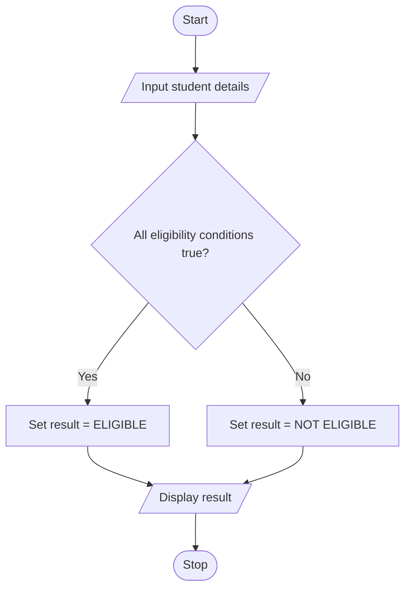

# Case 1: University Scholarship Allocation

## Aim
Check whether a student is eligible for a scholarship using aggregate marks, subject-wise marks, attendance, and annual family income.

**Formula:** Eligibility = aggregate ≥ 75 AND every subject mark ≥ 60 AND attendance ≥ 75 AND income ≤ 250000

---

## INPUT
| Variable | Type | Meaning | Example |
|----------|------|---------|---------|
| int_students | int | Number of students | 2 |
| str_name | str | Student name | Ravi |
| float_aggregate | float | Aggregate percentage | 80 |
| float_s1, float_s2, float_s3 | float | Marks in three subjects | 70, 75, 80 |
| float_attendance | float | Attendance percentage | 90 |
| float_income | float | Annual family income in rupees | 200000 |

---

## PROCESS
1. Read the student details.
2. Check aggregate percentage is at least 75.
3. Check each of the three subject marks is at least 60.
4. Check attendance is at least 75%.
5. Check annual family income is not more than Rs. 250000.
6. If all conditions are true, display ELIGIBLE; otherwise display NOT ELIGIBLE.

---

## OUTPUT
| Variable / report | Meaning | Example |
|-------------------|---------|---------|
| str_result | Eligibility result | ELIGIBLE or NOT ELIGIBLE |

---

## Algorithm
1. Start.
2. Read student name, aggregate, three subject marks, attendance, and annual income.
3. Check all eligibility conditions using AND.
4. If all conditions are satisfied, set result to ELIGIBLE.
5. Otherwise, set result to NOT ELIGIBLE.
6. Display student name and result.
7. Stop.

---

## Pseudocode
```text
BEGIN
    INPUT str_name, float_aggregate
    INPUT float_s1, float_s2, float_s3
    INPUT float_attendance, float_income

    IF float_aggregate >= 75 AND float_s1 >= 60 AND
       float_s2 >= 60 AND float_s3 >= 60 AND
       float_attendance >= 75 AND float_income <= 250000 THEN
        str_result = "ELIGIBLE"
    ELSE
        str_result = "NOT ELIGIBLE"
    END IF

    OUTPUT str_name, str_result
END
```

---

## Flowchart
**Shape rules**

| Shape | Meaning |
|-------|---------|
| Oval | Start / Stop |
| Parallelogram | Input / Output |
| Rectangle | Process |
| Diamond | Decision |



---

## Sample
**INPUT**
```text
Student: Ravi
Aggregate: 80
Subject marks: 70, 75, 80
Attendance: 90
Annual income: 200000
```

**PROCESS**
```text
80 ≥ 75 → True
70, 75, 80 are all ≥ 60 → True
90 ≥ 75 → True
200000 ≤ 250000 → True
All conditions are true.
```

**OUTPUT**
```text
Ravi is ELIGIBLE for scholarship.
Student: Ravi
Result: ELIGIBLE

```

## Conclusion
The program checks academic performance, attendance, and income using conditional statements and the logical AND operator. The eligibility limits are sample assumptions for this activity.
