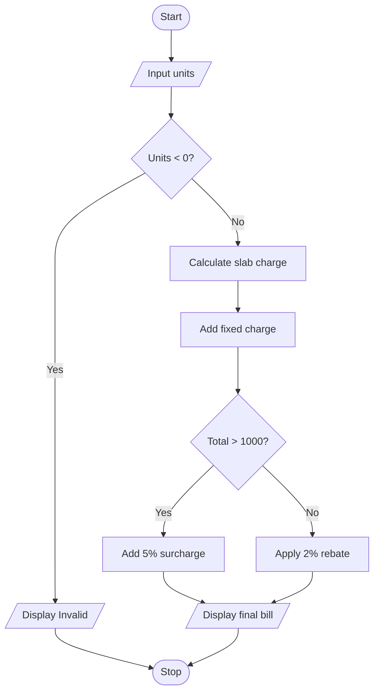

# Case 2: Progressive Electricity Billing

## Aim
Calculate a household electricity bill using progressive unit slabs, a fixed charge, and a conditional rebate or surcharge.

**Formula:** First 100 units: units × 2; next 100 units: 200 + (units − 100) × 3; above 200 units: 500 + (units − 200) × 5. Add Rs. 50 fixed charge. If total > Rs. 1000, add 5%; otherwise subtract 2%.

---

## INPUT
| Variable | Type | Meaning | Example |
|----------|------|---------|---------|
| float_units | float | Electricity units consumed | 150 |
| float_energy_charge | float | Charge calculated from slabs | 350 |
| float_fixed_charge | float | Fixed charge | 50 |
| float_total | float | Bill before adjustment | 400 |

---

## PROCESS
1. Read units consumed.
2. If units are negative, display Invalid units.
3. For up to 100 units, charge Rs. 2 per unit.
4. For 101 to 200 units, charge first 100 at Rs. 2 and remaining units at Rs. 3.
5. Above 200 units, charge first 100 at Rs. 2, next 100 at Rs. 3, and remaining units at Rs. 5.
6. Add fixed charge of Rs. 50.
7. If total is above Rs. 1000, add a 5% surcharge; otherwise apply a 2% rebate.
8. Display energy charge and final bill.

---

## OUTPUT
| Variable / report | Meaning | Example |
|-------------------|---------|---------|
| float_energy_charge | Energy charge | Calculated slab charge |
| float_final_bill | Final bill | Bill after fixed charge and adjustment |

---

## Algorithm
1. Start.
2. Read electricity units.
3. Validate that units are not negative.
4. Calculate the slab-wise energy charge using if-elif-else.
5. Add Rs. 50 fixed charge.
6. Apply 5% surcharge if total is above Rs. 1000; otherwise apply 2% rebate.
7. Display the energy charge and final bill.
8. Stop.

---

## Pseudocode
```text
BEGIN
    INPUT float_units
    IF float_units < 0 THEN
        OUTPUT "Invalid units"
    ELSE
        IF float_units <= 100 THEN
            float_energy = float_units * 2
        ELSE IF float_units <= 200 THEN
            float_energy = 100 * 2 + (float_units - 100) * 3
        ELSE
            float_energy = 100 * 2 + 100 * 3 + (float_units - 200) * 5
        END IF

        float_total = float_energy + 50
        IF float_total > 1000 THEN
            float_final = float_total + float_total * 5 / 100
        ELSE
            float_final = float_total - float_total * 2 / 100
        END IF
        OUTPUT float_energy, float_final
    END IF
END
```

---

## Flowchart
**Shape rules**

| Shape | Meaning |
|-------|---------|
| Oval | Start / Stop |
| Parallelogram | Input / Output |
| Rectangle | Process |
| Diamond | Decision |



---

## Sample
**INPUT**
```text
Units consumed: 150
```

**PROCESS**
```text
First 100 units = 100 × 2 = Rs. 200
Next 50 units = 50 × 3 = Rs. 150
Energy charge = Rs. 350
Add fixed charge Rs. 50 → Rs. 400
Rs. 400 is not above Rs. 1000, so rebate = 2% of 400 = Rs. 8.
```

**OUTPUT**
```text
Energy charge: Rs. 350.0
2% rebate applied.
Final bill: Rs. 392.0

```

## Conclusion
The program uses conditional statements and arithmetic operations to calculate a progressive electricity bill. The slab rates and adjustment rules are sample assumptions.
