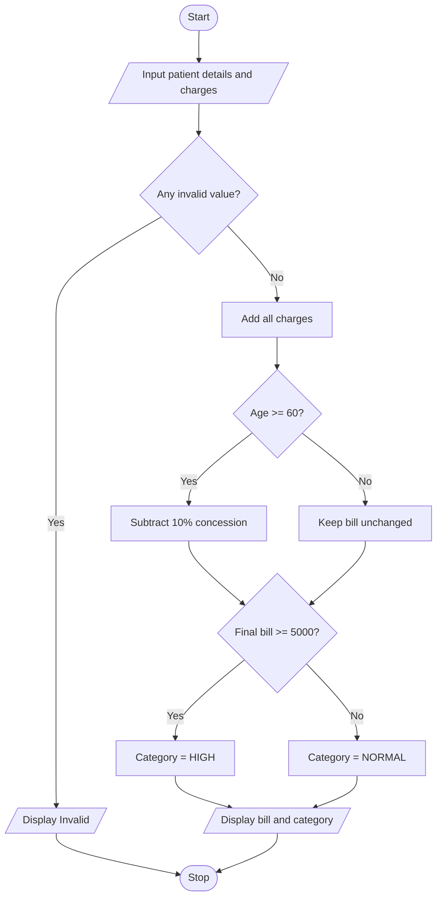

# Case 3: Hospital Billing and Patient Classification

## Aim
Calculate a patient's hospital bill from consultation, diagnostic, and treatment charges, apply a senior citizen concession, and classify the bill.

**Formula:** Bill before concession = consultation + diagnostic + treatment. For age ≥ 60, concession = 10% of bill. Final bill = bill − concession.

---

## INPUT
| Variable | Type | Meaning | Example |
|----------|------|---------|---------|
| str_name | str | Patient name | Meena |
| int_age | int | Patient age | 65 |
| float_consultation | float | Consultation charge | 500 |
| float_diagnostic | float | Diagnostic charge | 1000 |
| float_treatment | float | Treatment charge | 5000 |

---

## PROCESS
1. Read patient name, age, and all charges.
2. Check that age and charges are not negative.
3. Add consultation, diagnostic, and treatment charges.
4. If age is 60 or above, calculate and subtract a 10% concession.
5. If final bill is Rs. 5000 or more, classify it as HIGH; otherwise classify it as NORMAL.
6. Display patient name, final bill, and category.

---

## OUTPUT
| Variable / report | Meaning | Example |
|-------------------|---------|---------|
| float_bill | Final bill | Amount after concession |
| str_category | Bill category | HIGH or NORMAL |

---

## Algorithm
1. Start.
2. Read patient details and charges.
3. Validate age and charges.
4. Calculate the total bill.
5. If age is at least 60, apply 10% concession.
6. Classify final bill as HIGH or NORMAL.
7. Display the bill and classification.
8. Stop.

---

## Pseudocode
```text
BEGIN
    INPUT str_name, int_age
    INPUT float_consultation, float_diagnostic, float_treatment
    IF int_age < 0 OR any charge < 0 THEN
        OUTPUT "Invalid input"
    ELSE
        float_bill = float_consultation + float_diagnostic + float_treatment
        IF int_age >= 60 THEN
            float_concession = float_bill * 10 / 100
            float_bill = float_bill - float_concession
        END IF
        IF float_bill >= 5000 THEN
            str_category = "HIGH"
        ELSE
            str_category = "NORMAL"
        END IF
        OUTPUT str_name, float_bill, str_category
    END IF
END
```

---

## Flowchart
**Shape rules**

| Shape | Meaning |
|-------|---------|
| Oval | Start / Stop |
| Parallelogram | Input / Output |
| Rectangle | Process |
| Diamond | Decision |



---

## Sample
**INPUT**
```text
Name: Meena
Age: 65
Consultation: 500
Diagnostic: 1000
Treatment: 5000
```

**PROCESS**
```text
Bill = 500 + 1000 + 5000 = Rs. 6500
Age 65 is at least 60.
Concession = 10% of 6500 = Rs. 650
Final bill = 6500 − 650 = Rs. 5850
Rs. 5850 is at least Rs. 5000, so category = HIGH.
```

**OUTPUT**
```text
Senior citizen concession: Rs. 650.0
Patient: Meena
Final bill: Rs. 5850.0
Bill category: HIGH
Patient: Meena
Senior citizen concession: Rs. 650.0
Final bill: Rs. 5850.0
Bill category: HIGH

```

## Conclusion
The program calculates hospital charges, applies a concession using an if condition, and classifies the final bill. The concession and classification limits are sample assumptions.
