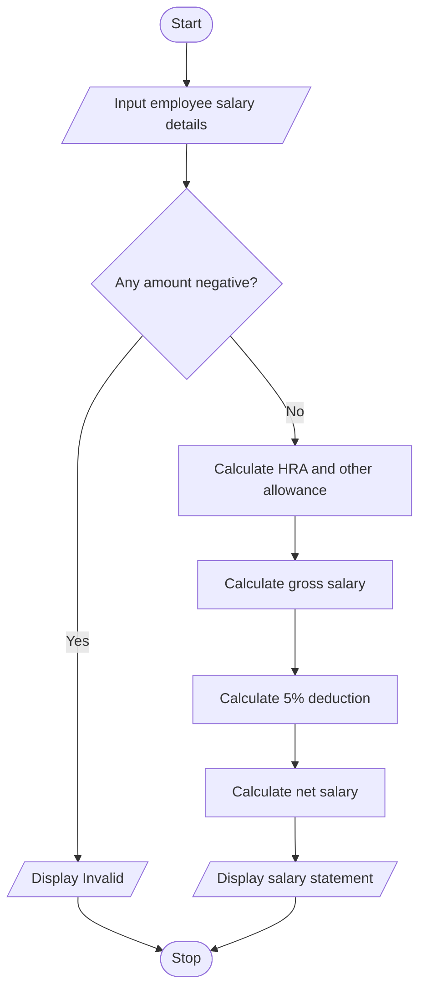

# Case 4: Employee Payroll and Deduction Analysis

## Aim
Calculate gross salary from basic pay, allowances, overtime, and incentives. Apply a deduction and display net salary.

**Formula:** HRA = 20% of basic pay. Other allowance = 10% of basic pay. Gross = basic + HRA + other allowance + overtime + incentive. Deduction = 5% of gross. Net salary = gross − deduction.

---

## INPUT
| Variable | Type | Meaning | Example |
|----------|------|---------|---------|
| str_name | str | Employee name | Ravi |
| float_basic | float | Basic pay | 20000 |
| float_overtime | float | Overtime amount | 1000 |
| float_incentive | float | Incentive amount | 500 |

---

## PROCESS
1. Read employee name, basic pay, overtime, and incentive.
2. If any amount is negative, display invalid salary details.
3. Calculate HRA as 20% of basic pay.
4. Calculate other allowance as 10% of basic pay.
5. Calculate gross salary.
6. Calculate deduction as 5% of gross salary.
7. Subtract deduction from gross salary to get net salary.
8. Display the salary statement.

---

## OUTPUT
| Variable / report | Meaning | Example |
|-------------------|---------|---------|
| float_gross | Gross salary | Salary before deduction |
| float_deduction | Deduction | 5% of gross salary |
| float_net_salary | Net salary | Gross salary minus deduction |

---

## Algorithm
1. Start.
2. Read employee details and salary components.
3. Validate that all amounts are non-negative.
4. Calculate HRA and other allowance.
5. Calculate gross salary.
6. Calculate 5% deduction and net salary.
7. Display the salary statement.
8. Stop.

---

## Pseudocode
```text
BEGIN
    INPUT str_name, float_basic, float_overtime, float_incentive
    IF any amount < 0 THEN
        OUTPUT "Invalid salary details"
    ELSE
        float_hra = float_basic * 20 / 100
        float_other = float_basic * 10 / 100
        float_gross = float_basic + float_hra + float_other + float_overtime + float_incentive
        float_deduction = float_gross * 5 / 100
        float_net = float_gross - float_deduction
        OUTPUT salary statement
    END IF
END
```

---

## Flowchart
**Shape rules**

| Shape | Meaning |
|-------|---------|
| Oval | Start / Stop |
| Parallelogram | Input / Output |
| Rectangle | Process |
| Diamond | Decision |



---

## Sample
**INPUT**
```text
Employee: Ravi
Basic pay: 20000
Overtime: 1000
Incentive: 500
```

**PROCESS**
```text
HRA = 20% of 20000 = Rs. 4000
Other allowance = 10% of 20000 = Rs. 2000
Gross = 20000 + 4000 + 2000 + 1000 + 500 = Rs. 27500
Deduction = 5% of 27500 = Rs. 1375
Net salary = Rs. 26125
```

**OUTPUT**
```text
----- SALARY STATEMENT -----
Employee: Ravi
Basic pay: Rs. 20000.0
HRA: Rs. 4000.0
Other allowance: Rs. 2000.0
Overtime: Rs. 1000.0
Incentive: Rs. 500.0
Gross salary: Rs. 27500.0
Deduction: Rs. 1375.0
Net salary: Rs. 26125.0
Gross salary: Rs. 27500.0
Deduction: Rs. 1375.0
Net salary: Rs. 26125.0

```

## Conclusion
The program uses arithmetic operations to calculate gross salary, deductions, and net salary. The allowance and deduction rates are sample assumptions.
