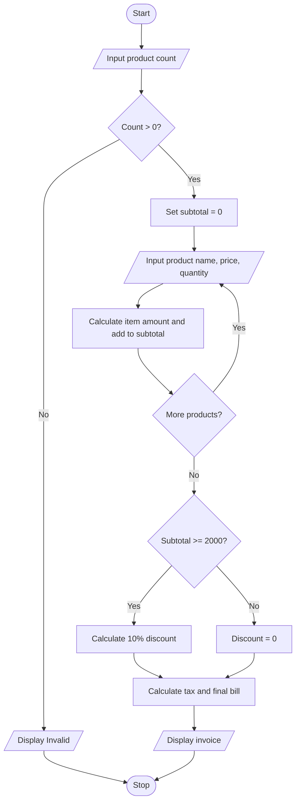

# Case 5: Retail Billing with Multiple Discount Rules

## Aim
Process multiple products, calculate item amounts, apply a discount based on subtotal, add tax, and display a bill.

**Formula:** Item amount = price × quantity. If subtotal ≥ Rs. 2000, discount = 10% of subtotal; otherwise discount = 0. Tax = 5% of (subtotal − discount). Final bill = subtotal − discount + tax.

---

## INPUT
| Variable | Type | Meaning | Example |
|----------|------|---------|---------|
| int_count | int | Number of products | 2 |
| str_name | str | Product name | Pen |
| float_price | float | Price of one item | 20 |
| int_quantity | int | Quantity purchased | 2 |

---

## PROCESS
1. Read the number of products. It must be positive.
2. For each product, read product name, price, and quantity.
3. Check price is non-negative and quantity is positive.
4. Calculate item amount and add it to subtotal.
5. If subtotal is at least Rs. 2000, apply a 10% discount.
6. Calculate 5% tax on the discounted amount.
7. Display subtotal, discount, tax, and final bill.

---

## OUTPUT
| Variable / report | Meaning | Example |
|-------------------|---------|---------|
| float_subtotal | Subtotal | Sum of all item amounts |
| float_discount | Discount | Discount amount |
| float_tax | Tax | Tax on discounted subtotal |
| float_final_bill | Final bill | Amount payable |

---

## Algorithm
1. Start.
2. Read number of products.
3. If count is not positive, display invalid product count.
4. Repeat for each product: read name, price, quantity and calculate amount.
5. Add each valid amount to subtotal.
6. Apply 10% discount if subtotal is at least Rs. 2000.
7. Calculate 5% tax and final bill.
8. Display bill details.
9. Stop.

---

## Pseudocode
```text
BEGIN
    INPUT int_count
    float_subtotal = 0
    IF int_count <= 0 THEN
        OUTPUT "Invalid product count"
    ELSE
        FOR each product
            INPUT str_name, float_price, int_quantity
            IF float_price < 0 OR int_quantity <= 0 THEN
                OUTPUT "Invalid product details"
                STOP
            END IF
            float_amount = float_price * int_quantity
            float_subtotal = float_subtotal + float_amount
        END FOR
        IF float_subtotal >= 2000 THEN
            float_discount = float_subtotal * 10 / 100
        ELSE
            float_discount = 0
        END IF
        float_tax = (float_subtotal - float_discount) * 5 / 100
        float_final = float_subtotal - float_discount + float_tax
        OUTPUT float_subtotal, float_discount, float_tax, float_final
    END IF
END
```

---

## Flowchart
**Shape rules**

| Shape | Meaning |
|-------|---------|
| Oval | Start / Stop |
| Parallelogram | Input / Output |
| Rectangle | Process |
| Diamond | Decision |



---

## Sample
**INPUT**
```text
Products:
Pen: price 20, quantity 2
Bag: price 1000, quantity 2
```

**PROCESS**
```text
Pen amount = 20 × 2 = Rs. 40
Bag amount = 1000 × 2 = Rs. 2000
Subtotal = Rs. 2040
Discount = 10% of 2040 = Rs. 204
Tax = 5% of (2040 − 204) = Rs. 91.80
Final bill = 2040 − 204 + 91.80 = Rs. 1927.80
```

**OUTPUT**
```text
Pen amount: Rs. 40.0
Bag amount: Rs. 2000.0
Subtotal: Rs. 2040.0
Discount: Rs. 204.0
Tax: Rs. 91.8
Final bill: Rs. 1927.8
Subtotal: Rs. 2040.0
Discount: Rs. 204.0
Tax: Rs. 91.8
Final bill: Rs. 1927.8

```

## Conclusion
The program uses a for loop to process multiple products and calculates discounts and tax using arithmetic and conditional statements.
