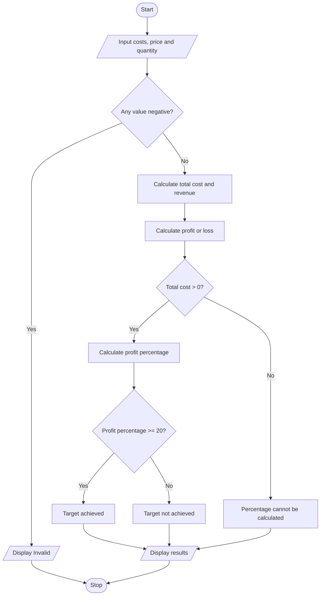

# Case 6: Manufacturing Cost and Profitability Analysis

## Aim
Calculate manufacturing cost from material, labour, machine, and wastage costs. Compare sales revenue with total cost to find profit or loss.

**Formula:** Total cost = material + labour + machine + wastage. Revenue = selling price × quantity. Profit = revenue − total cost. Profit % = (profit / total cost) × 100, when total cost is greater than zero.

---

## INPUT
| Variable | Type | Meaning | Example |
|----------|------|---------|---------|
| float_material | float | Material cost | 5000 |
| float_labour | float | Labour cost | 1000 |
| float_machine | float | Machine cost | 500 |
| float_wastage | float | Wastage cost | 500 |
| float_selling_price | float | Selling price per item | 100 |
| int_quantity | int | Quantity sold | 100 |

---

## PROCESS
1. Read all production costs, selling price, and quantity.
2. Validate that all values are non-negative.
3. Add production costs to calculate total cost.
4. Multiply selling price by quantity to calculate revenue.
5. Subtract total cost from revenue to calculate profit or loss.
6. If profit is positive, display profit; if negative, display loss.
7. If total cost is greater than zero, calculate profit percentage and check whether it is at least 20%.
8. Display results.

---

## OUTPUT
| Variable / report | Meaning | Example |
|-------------------|---------|---------|
| float_total_cost | Total cost | Sum of production costs |
| float_revenue | Revenue | Selling price multiplied by quantity |
| float_profit | Profit or loss | Revenue minus total cost |
| float_profit_percent | Profit percentage | Profit divided by total cost × 100 |

---

## Algorithm
1. Start.
2. Read material, labour, machine, and wastage costs.
3. Read selling price and quantity.
4. Validate all values.
5. Calculate total cost and revenue.
6. Calculate profit or loss.
7. If total cost is greater than zero, calculate profit percentage.
8. Check whether profit percentage is at least 20%.
9. Display results.
10. Stop.

---

## Pseudocode
```text
BEGIN
    INPUT material, labour, machine, wastage
    INPUT selling_price, quantity
    IF any input < 0 THEN
        OUTPUT "Invalid input"
    ELSE
        total_cost = material + labour + machine + wastage
        revenue = selling_price * quantity
        profit = revenue - total_cost
        IF profit > 0 THEN OUTPUT "Profit"
        ELSE IF profit < 0 THEN OUTPUT "Loss"
        ELSE OUTPUT "No profit, no loss"
        END IF
        IF total_cost > 0 THEN
            profit_percent = profit / total_cost * 100
            IF profit_percent >= 20 THEN OUTPUT "Target achieved"
            ELSE OUTPUT "Target not achieved"
            END IF
        END IF
    END IF
END
```

---

## Flowchart
**Shape rules**

| Shape | Meaning |
|-------|---------|
| Oval | Start / Stop |
| Parallelogram | Input / Output |
| Rectangle | Process |
| Diamond | Decision |



---

## Sample
**INPUT**
```text
Material: 5000
Labour: 1000
Machine: 500
Wastage: 500
Selling price per item: 100
Quantity sold: 100
```

**PROCESS**
```text
Total cost = 5000 + 1000 + 500 + 500 = Rs. 7000
Revenue = 100 × 100 = Rs. 10000
Profit = 10000 − 7000 = Rs. 3000
Profit percentage = 3000 / 7000 × 100 = 42.86%
42.86% ≥ 20%, so target is achieved.
```

**OUTPUT**
```text
Total production cost: Rs. 7000.0
Sales revenue: Rs. 10000.0
Profit: Rs. 3000.0
Profit percentage: 42.86%
Target profit achieved.

```

## Conclusion
The program calculates production cost, sales revenue, and profit or loss, then compares profit percentage with the sample target.
