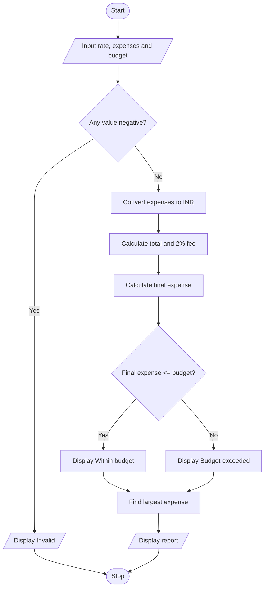

# Case 7: Multi-Currency Travel Budget Analysis

## Aim
Convert travel expenses from a foreign currency into rupees, include a conversion fee, compare spending with a budget, and identify the largest expense category.

**Formula:** Expense in INR = foreign expense × exchange rate. Conversion fee = 2% of total converted expenses. Final expense = total converted expenses + fee.

---

## INPUT
| Variable | Type | Meaning | Example |
|----------|------|---------|---------|
| float_rate | float | Rupees for one foreign currency unit | 80 |
| float_food | float | Food expense in foreign currency | 50 |
| float_travel | float | Travel expense in foreign currency | 100 |
| float_hotel | float | Hotel expense in foreign currency | 200 |
| float_budget | float | Budget in rupees | 30000 |

---

## PROCESS
1. Read exchange rate, food, travel, hotel expenses, and budget.
2. Validate that all values are non-negative.
3. Convert each expense into rupees using the exchange rate.
4. Add converted expenses.
5. Calculate 2% conversion fee.
6. Add fee to total expense.
7. Compare final expense with budget.
8. Find and display the largest expense category.

---

## OUTPUT
| Variable / report | Meaning | Example |
|-------------------|---------|---------|
| float_total | Converted expenses | Sum of food, travel, and hotel expenses in INR |
| float_fee | Conversion fee | 2% of converted expenses |
| float_final | Final expense | Converted expenses plus fee |
| str_largest | Largest expense category | Food, Travel, or Hotel |

---

## Algorithm
1. Start.
2. Read exchange rate, expenses, and budget.
3. Validate all inputs.
4. Convert food, travel, and hotel expenses to rupees.
5. Calculate total and conversion fee.
6. Calculate final expense.
7. Compare final expense with budget.
8. Find largest expense category.
9. Display report.
10. Stop.

---

## Pseudocode
```text
BEGIN
    INPUT rate, food, travel, hotel, budget
    IF any input < 0 THEN
        OUTPUT "Invalid input"
    ELSE
        food_inr = food * rate
        travel_inr = travel * rate
        hotel_inr = hotel * rate
        total = food_inr + travel_inr + hotel_inr
        fee = total * 2 / 100
        final = total + fee
        IF final <= budget THEN OUTPUT "Within budget"
        ELSE OUTPUT "Budget exceeded"
        END IF
        FIND largest among food_inr, travel_inr, hotel_inr
        OUTPUT final, largest
    END IF
END
```

---

## Flowchart
**Shape rules**

| Shape | Meaning |
|-------|---------|
| Oval | Start / Stop |
| Parallelogram | Input / Output |
| Rectangle | Process |
| Diamond | Decision |



---

## Sample
**INPUT**
```text
Exchange rate: 80
Food: 50 foreign units
Travel: 100 foreign units
Hotel: 200 foreign units
Budget: Rs. 30000
```

**PROCESS**
```text
Food = 50 × 80 = Rs. 4000
Travel = 100 × 80 = Rs. 8000
Hotel = 200 × 80 = Rs. 16000
Total = Rs. 28000
Fee = 2% of 28000 = Rs. 560
Final expense = Rs. 28560
Rs. 28560 ≤ Rs. 30000, so within budget. Hotel is the largest expense.
```

**OUTPUT**
```text
Food in Rs.: 4000.0
Travel in Rs.: 8000.0
Hotel in Rs.: 16000.0
Conversion fee: Rs. 560.0
Total expense: Rs. 28560.0
Within budget.
Largest expense: Hotel

```

## Conclusion
The program demonstrates currency conversion, percentage calculation, budget comparison, and finding the largest expense category.
