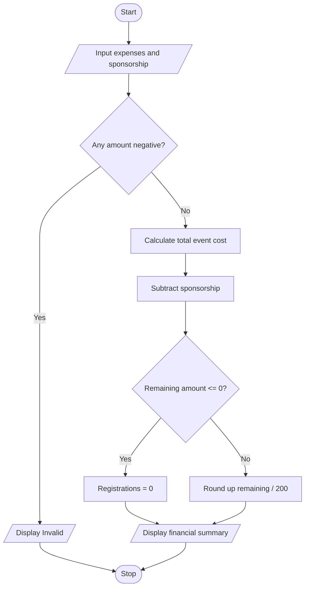

# Case 8: Campus Event Financial Planning

## Aim
Calculate campus event expenses, subtract sponsorship, and find the minimum number of registrations required to cover the remaining cost.

**Formula:** Total cost = venue + equipment + catering + transport + certificates. Remaining amount = total cost − sponsorship. Minimum registrations = ceiling(remaining amount / 200), if remaining amount is positive.

---

## INPUT
| Variable | Type | Meaning | Example |
|----------|------|---------|---------|
| float_venue | float | Venue cost | 5000 |
| float_equipment | float | Equipment cost | 2000 |
| float_catering | float | Catering cost | 10000 |
| float_transport | float | Transport cost | 3000 |
| float_certificates | float | Certificate cost | 1000 |
| float_sponsorship | float | Sponsorship amount | 5000 |
| float_registration_fee | float | Fee per participant | 200 |

---

## PROCESS
1. Read all event expenses and sponsorship amount.
2. Validate that all amounts are non-negative.
3. Add expenses to calculate total event cost.
4. Subtract sponsorship from total cost.
5. If remaining amount is zero or less, no registrations are required to cover expenses.
6. Otherwise divide remaining amount by Rs. 200 and round up to the next whole participant.
7. Display total cost, sponsorship, remaining amount, and registrations.

---

## OUTPUT
| Variable / report | Meaning | Example |
|-------------------|---------|---------|
| float_total | Total event cost | Sum of all expenses |
| float_remaining | Amount to be collected | Total cost minus sponsorship |
| int_registrations | Minimum registrations | Whole participants needed |

---

## Algorithm
1. Start.
2. Read venue, equipment, catering, transport, certificate costs, and sponsorship.
3. Validate all amounts.
4. Calculate total event cost.
5. Subtract sponsorship.
6. If remaining amount is not positive, set registrations to zero.
7. Otherwise calculate the minimum whole registrations at Rs. 200 each.
8. Display financial summary.
9. Stop.

---

## Pseudocode
```text
BEGIN
    INPUT venue, equipment, catering, transport, certificates, sponsorship
    total = venue + equipment + catering + transport + certificates
    remaining = total - sponsorship
    registration_fee = 200
    IF remaining <= 0 THEN
        registrations = 0
    ELSE
        registrations = integer(remaining / registration_fee)
        IF remaining MOD registration_fee != 0 THEN
            registrations = registrations + 1
        END IF
    END IF
    OUTPUT total, sponsorship, remaining, registrations
END
```

---

## Flowchart
**Shape rules**

| Shape | Meaning |
|-------|---------|
| Oval | Start / Stop |
| Parallelogram | Input / Output |
| Rectangle | Process |
| Diamond | Decision |



---

## Sample
**INPUT**
```text
Venue: 5000
Equipment: 2000
Catering: 10000
Transport: 3000
Certificates: 1000
Sponsorship: 5000
```

**PROCESS**
```text
Total event cost = Rs. 21000
Remaining = 21000 − 5000 = Rs. 16000
Registration fee = Rs. 200
Registrations = 16000 / 200 = 80
```

**OUTPUT**
```text
Total event cost: Rs. 21000.0
Sponsorship: Rs. 5000.0
Amount to be collected: Rs. 16000.0
Minimum registrations needed: 80

```

## Conclusion
The program uses arithmetic and conditional statements to calculate event expenses and the minimum registrations needed to cover the cost.
