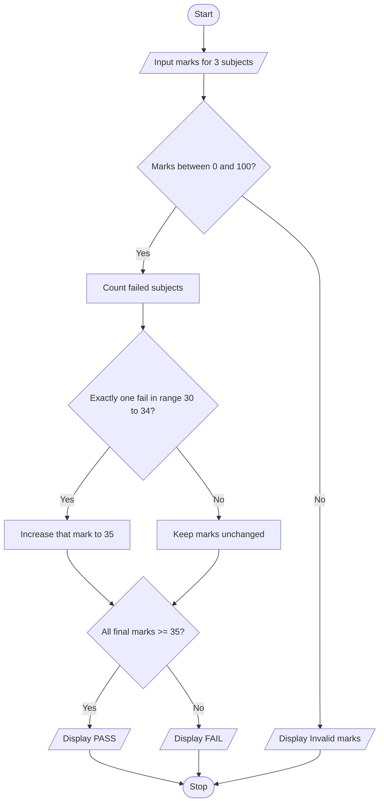

# Case 9: Examination Result and Grace-Mark Validation

## Aim
Process marks in three subjects, apply a limited grace-mark rule, and display the final result.

**Formula:** Pass mark = 35. If exactly one subject has marks from 30 to 34 and the other subjects pass, add enough grace marks to make that subject 35.

---

## INPUT
| Variable | Type | Meaning | Example |
|----------|------|---------|---------|
| list_marks | list | Marks in three subjects | [70, 32, 80] |
| int_pass_mark | int | Minimum pass mark | 35 |
| int_grace | int | Grace marks required | 3 |

---

## PROCESS
1. Read marks for three subjects and store them in a list.
2. Check that every mark is between 0 and 100.
3. Count subjects with marks below 35.
4. If exactly one subject has marks from 30 to 34, add enough grace marks to make it 35.
5. Check the final marks again.
6. Display PASS if all subjects have at least 35; otherwise display FAIL.

---

## OUTPUT
| Variable / report | Meaning | Example |
|-------------------|---------|---------|
| list_marks | Final subject marks | Marks after any grace marks |
| str_result | Final result | PASS or FAIL |

---

## Algorithm
1. Start.
2. Create an empty list for marks.
3. Read marks for three subjects and append each mark.
4. Validate marks from 0 to 100.
5. Count failed subjects and identify a subject in the grace range.
6. If exactly one subject failed and it is in the grace range, raise it to 35.
7. Check all subjects again.
8. Display final marks and result.
9. Stop.

---

## Pseudocode
```text
BEGIN
    marks = empty list
    FOR i = 1 TO 3
        INPUT mark
        ADD mark TO marks
    END FOR
    IF any mark < 0 OR mark > 100 THEN
        OUTPUT "Invalid marks"
    ELSE
        COUNT subjects with marks < 35
        IF exactly one failed subject AND its mark >= 30 THEN
            SET that subject mark = 35
        END IF
        IF every mark >= 35 THEN
            OUTPUT "PASS"
        ELSE
            OUTPUT "FAIL"
        END IF
        OUTPUT marks
    END IF
END
```

---

## Flowchart
**Shape rules**

| Shape | Meaning |
|-------|---------|
| Oval | Start / Stop |
| Parallelogram | Input / Output |
| Rectangle | Process |
| Diamond | Decision |



---

## Sample
**INPUT**
```text
Subject 1: 70
Subject 2: 32
Subject 3: 80
```

**PROCESS**
```text
Failed subjects = 1
Subject 2 has 32 marks, which is between 30 and 34.
Grace marks = 35 − 32 = 3
Final marks = [70, 35, 80]
All subjects have at least 35, so result = PASS.
```

**OUTPUT**
```text
Grace marks awarded: 3
Final marks: [70, 35, 80]
RESULT: PASS

```

## Conclusion
The program uses a list, loops, and conditional statements to validate marks and apply the sample grace-mark rule.
