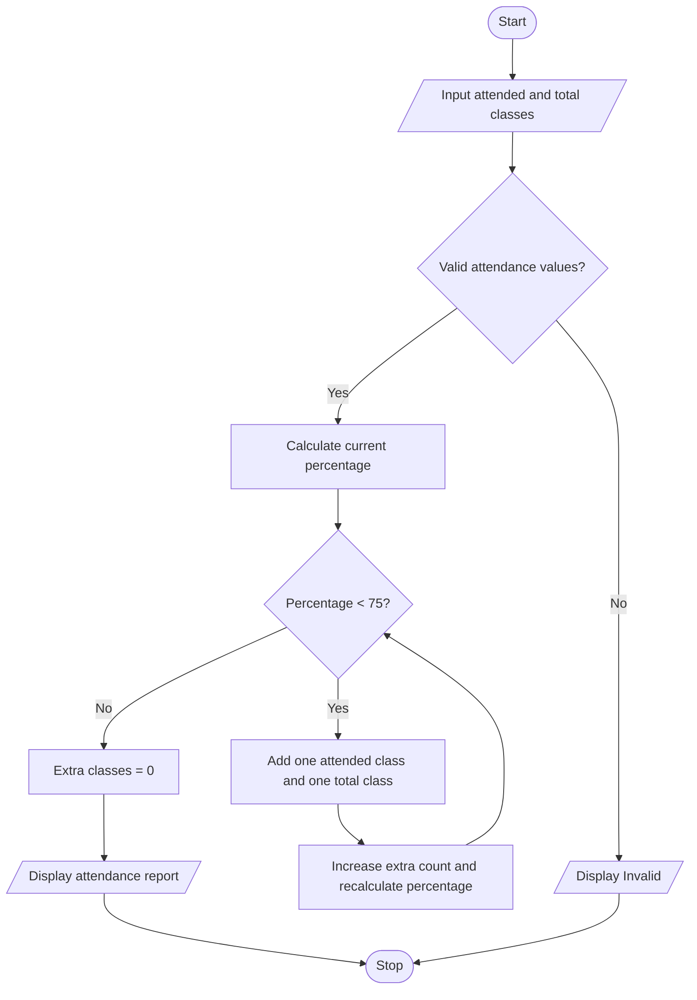

# Case 10: Attendance Recovery Computation

## Aim
Calculate current attendance percentage and find the minimum additional consecutive classes a student must attend to reach 75%.

**Formula:** Attendance % = (classes attended / total classes) × 100. Each future attended class increases both attended classes and total classes by one.

---

## INPUT
| Variable | Type | Meaning | Example |
|----------|------|---------|---------|
| int_attended | int | Classes attended so far | 60 |
| int_total | int | Total classes conducted so far | 100 |
| float_percentage | float | Current attendance percentage | 60.0 |
| int_extra | int | Additional classes needed | 60 |

---

## PROCESS
1. Read classes attended and total classes conducted.
2. Check total classes is greater than zero and attended classes are between zero and total classes.
3. Calculate current attendance percentage.
4. If current attendance is already at least 75%, no extra classes are needed.
5. Otherwise, use a while loop: add one to attended and total classes until percentage reaches 75%.
6. Display current percentage, extra classes required, and final percentage.

---

## OUTPUT
| Variable / report | Meaning | Example |
|-------------------|---------|---------|
| float_percentage | Current attendance | Current percentage |
| int_extra | Additional classes | Minimum future classes to attend |
| float_final_percentage | Final attendance | Percentage after attending extra classes |

---

## Algorithm
1. Start.
2. Read attended classes and total classes.
3. Validate attendance values.
4. Calculate current attendance percentage.
5. Set extra classes to zero.
6. While percentage is below 75, increase attended classes, total classes, and extra count by one; recalculate percentage.
7. Display additional classes and final attendance.
8. Stop.

---

## Pseudocode
```text
BEGIN
    INPUT int_attended, int_total
    IF int_total <= 0 OR int_attended < 0 OR int_attended > int_total THEN
        OUTPUT "Invalid attendance details"
    ELSE
        percentage = int_attended / int_total * 100
        extra = 0
        WHILE percentage < 75 DO
            int_attended = int_attended + 1
            int_total = int_total + 1
            extra = extra + 1
            percentage = int_attended / int_total * 100
        END WHILE
        OUTPUT extra, percentage
    END IF
END
```

---

## Flowchart
**Shape rules**

| Shape | Meaning |
|-------|---------|
| Oval | Start / Stop |
| Parallelogram | Input / Output |
| Rectangle | Process |
| Diamond | Decision |



---

## Sample
**INPUT**
```text
Classes attended: 60
Total classes conducted: 100
```

**PROCESS**
```text
Current attendance = 60 / 100 × 100 = 60%
After 60 additional attended classes: 120 / 160 × 100 = 75%
Minimum additional classes = 60.
```

**OUTPUT**
```text
Current attendance: 60.0%
Minimum additional classes to attend: 60
Attendance after extra classes: 75.0%

```

## Conclusion
The program uses a while loop to calculate the minimum additional classes required to reach the sample attendance target of 75%.
